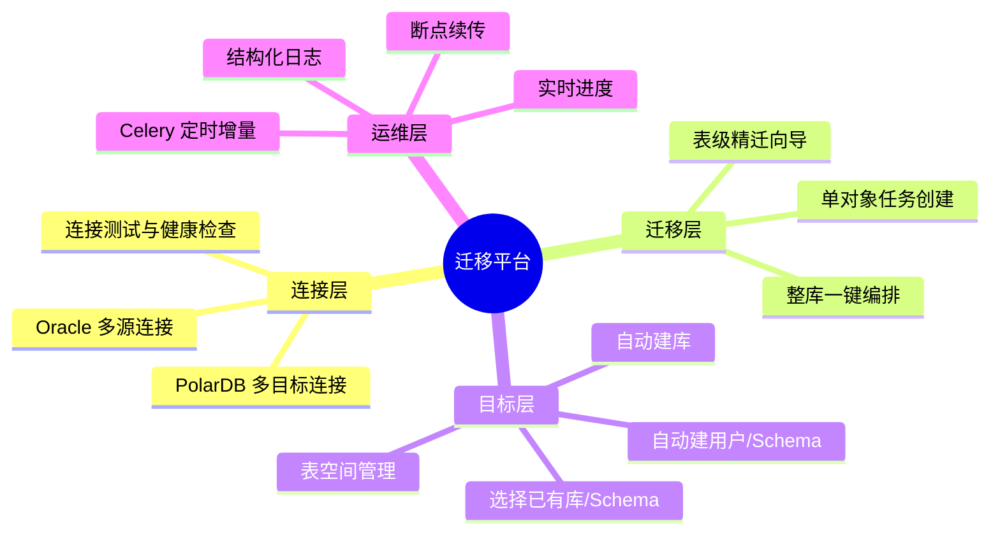
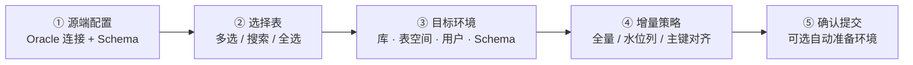
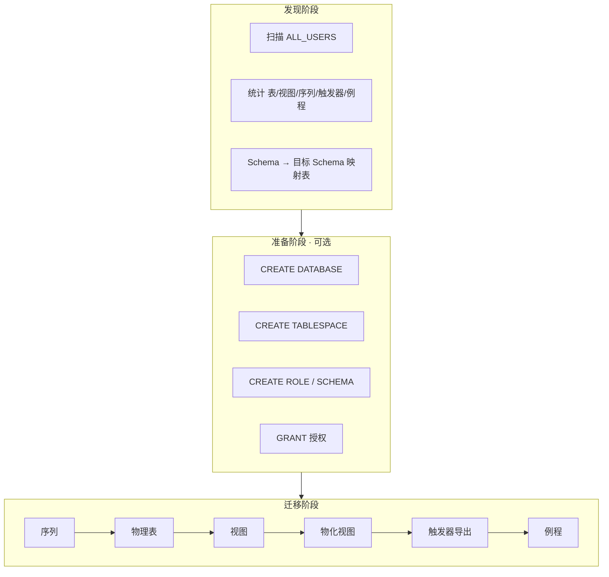
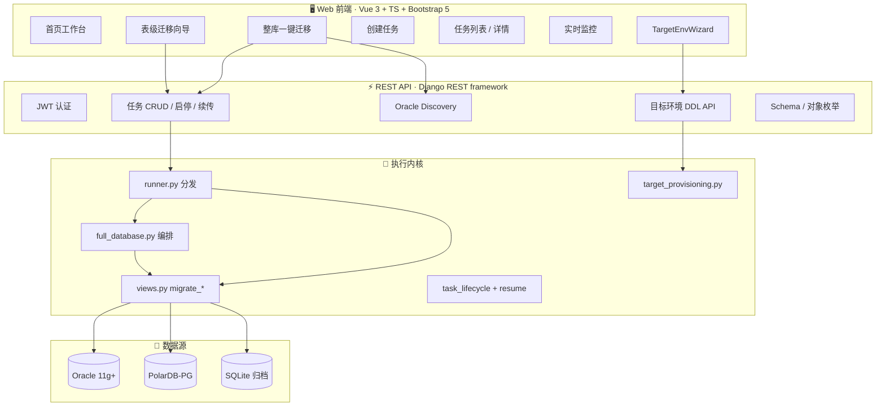
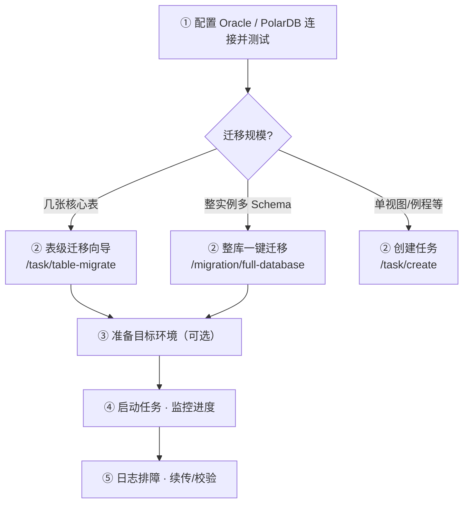

<p align="center">
  
</p>

<h1 align="center">Oracle → PolarDB PostgreSQL</h1>
<h3 align="center">企业级迁移与同步平台</h3>

<p align="center">
  <strong>一站式上云 · 表级精迁 · 整库编排 · 目标环境自动就绪</strong>
</p>

<p align="center">
  
  
  
  
</p>

<p align="center">
  
  
  
  
</p>

<br/>

<table align="center">
  <tr>
    <td align="center" width="25%">
      <strong>📋 表级迁移向导</strong><br/>
      <sub>按表勾选 · 增量同步 · 目标环境配置</sub>
    </td>
    <td align="center" width="25%">
      <strong>☁️ 整库一键迁移</strong><br/>
      <sub>多 Schema · 全对象编排 · 阶段进度</sub>
    </td>
    <td align="center" width="25%">
      <strong>🛠 目标环境 DDL</strong><br/>
      <sub>建库 · 表空间 · 用户 · Schema</sub>
    </td>
    <td align="center" width="25%">
      <strong>📡 实时监控</strong><br/>
      <sub>进度轮询 · 日志审计 · 主键对比</sub>
    </td>
  </tr>
</table>

<br/>

---

## 📋 目录

<details open>
<summary><strong>点击展开 / 收起导航</strong></summary>

- [产品概述](#-产品概述)
- [亮点功能 · v2](#-亮点功能--v2)
  - [表级迁移向导](#-表级迁移向导)
  - [整库一键迁移](#-整库一键迁移)
  - [目标环境自动就绪](#-目标环境自动就绪)
- [适用场景与版本](#-适用场景与版本)
- [核心功能矩阵](#-核心功能矩阵)
- [系统架构](#-系统架构)
- [导航与路由地图](#-导航与路由地图)
- [快速开始](#-快速开始)
- [使用手册](#-使用手册)
- [API 速查 · 新增](#-api-速查--新增)
- [开发指南](#-开发指南)
- [文档与支持](#-文档与支持)
- [许可证](#-许可证)

</details>

---

## 🎯 产品概述

**Oracle 到 PolarDB PostgreSQL 迁移平台** 是一套面向企业级场景的数据库迁移与数据同步解决方案。帮助客户将 Oracle 11g 及更高版本的结构与数据，安全、可控地迁移至阿里云 PolarDB PostgreSQL 兼容引擎，并支持**任务编排、目标环境预置、增量同步、断点续传**与全链路可观测。



| 能力维度 | 说明 |
|:--------:|:-----|
| **一站式** | 连接配置 → 对象选择 → 目标就绪 → 执行监控，全流程 Web 化 |
| **可编排** | 单表、多表、整 Schema、**整实例多 Schema** 多粒度迁移 |
| **可增量** | 水位列追加、主键对齐定时增删，配合 Celery Beat |
| **可观测** | 任务/对象/阶段三级进度，日志审计与失败诊断 |
| **可续传** | 大表、多表、整库编排均支持断点恢复 |

---

## ✨ 亮点功能 · v2

> 🆕 以下为本版本重点交付能力：**表级迁移向导**、**整库一键迁移**、**PolarDB 目标环境 DDL**。

### 📋 表级迁移向导

**入口**：侧边栏 `迁移管理 → 表级迁移` · 路由 `/task/table-migrate`

五步向导，将「选表 + 配目标 + 定增量」收敛为一条清晰路径：



| 步骤 | 能力 | 说明 |
|:----:|:-----|:-----|
| ① | 源端 | 选择 Oracle 连接与 Schema，自动加载表列表 |
| ② | 选表 | 仅 `TABLE` 类型，支持搜索、全选、批量勾选 |
| ③ | 目标 | 复用 `TargetEnvWizard`：选已有或**新建**库/表空间/用户/Schema |
| ④ | 增量 | `none` 全量 · `timestamp` 水位列 · `pk_mirror` 主键对齐 + 定时 |
| ⑤ | 提交 | 可选 `prepare_target` 先执行 DDL，再创建 `table` 类型任务 |

**典型场景**：核心业务表分批上云、按表增量同步、目标库尚未在 PolarDB 控制台手工创建。

---

### ☁️ 整库一键迁移

**入口**：侧边栏 `迁移管理 → 整库一键迁移` · 路由 `/migration/full-database`

单 Oracle 连接下，自动发现全部非系统 Schema，按依赖顺序编排迁移：



| 编排阶段 | 行为 | 续传 |
|:--------:|:-----|:----:|
| 准备环境 | 按向导配置自动建库/用户/Schema | — |
| 序列 | 全 Schema 序列先行创建 | ✅ |
| 物理表 | 逐 Schema、逐表结构+数据迁移 | ✅ |
| 视图 | 定义或物化（复用现有 `migrate_view`） | ✅ |
| 物化视图 | MV 定义与数据 | ✅ |
| 触发器 | **导出源码模板**，不自动下发 DDL | ✅ |
| 例程 | 存储过程/函数基础语法转换 | ✅ |

任务详情页展示**多阶段进度条**、当前 Schema、已完成/失败对象列表，支持「继续迁移」断点续传。

---

### 🛠 目标环境自动就绪

通过 `TargetEnvWizard` 组件与后端 `target_provisioning` 模块，在 Web 端完成 PolarDB 侧环境准备，无需反复登录控制台：

```
┌─────────────────────────────────────────────────────────────┐
│  TargetEnvWizard · 目标环境配置面板                          │
├─────────────────────────────────────────────────────────────┤
│  📦 数据库    [ 选择已有 ▼ ] [ 新建 ▼ ]  名称 · 编码 UTF8    │
│  💾 表空间    [ 默认 ▼ ] [ 已有 ▼ ] [ 新建 + LOCATION 路径 ]  │
│  👤 用户      [ 跳过 ▼ ] [ 已有 ▼ ] [ 新建 + 密码 + CREATEDB ]│
│  📂 Schema    [ 已有 public ▼ ] [ 新建 + 所有者 ]            │
├─────────────────────────────────────────────────────────────┤
│  [ 🔧 测试并准备环境 ]  →  POST /api/target-env/prepare/    │
└─────────────────────────────────────────────────────────────┘
```

| 资源 | 模式 | 权限要求 |
|:-----|:-----|:---------|
| 数据库 | `existing` / `create` / `skip` | `CREATEDB` 或超级用户 |
| 表空间 | `skip` / `existing` / `create` | 超级用户 + 服务器目录路径 |
| 用户 | `skip` / `existing` / `create` | `CREATEROLE` 或超级用户 |
| Schema | `existing` / `create` | 目标库 `CREATE` 权限 |

> ⚠️ 表空间创建需 PolarDB 实例文件系统路径；无超级用户权限时，可回退「使用默认表空间」仅完成库/用户/Schema 准备。

---

## 📌 适用场景与版本

<table>
  <thead>
    <tr>
      <th width="20%">维度</th>
      <th>说明</th>
    </tr>
  </thead>
  <tbody>
    <tr>
      <td><strong>源端</strong></td>
      <td>Oracle Database <strong>11g+</strong>（如 11.2.0.4），Schema = <code>ALL_USERS.USERNAME</code></td>
    </tr>
    <tr>
      <td><strong>目标端</strong></td>
      <td>阿里云 <strong>PolarDB PostgreSQL</strong> 或兼容 PostgreSQL 15 的实例</td>
    </tr>
    <tr>
      <td><strong>精迁场景</strong></td>
      <td>按表选择、增量同步、目标库/用户/Schema 尚未就绪</td>
    </tr>
    <tr>
      <td><strong>整库场景</strong></td>
      <td>单实例多 Schema、多对象类型一次性编排上云</td>
    </tr>
    <tr>
      <td><strong>归档场景</strong></td>
      <td>视图数据导出 SQLite，便于离线分析</td>
    </tr>
  </tbody>
</table>

---

## ✨ 核心功能矩阵

### 🔗 连接与配置

| 模块 | 能力 |
|:-----|:-----|
| Oracle 连接 | 多源库 CRUD、连接测试、Schema/用户/对象枚举 |
| PolarDB 连接 | 多实例、SSL、多库列表、Schema/用户/表空间查询 |
| 任务级目标 | 连接 → 数据库 → Schema 三步选择；支持运行时切换目标库 |
| 全局策略 | 默认大小写、冲突策略、批量大小（系统配置页） |

### 📦 对象迁移能力

| 类型 | 标识 | 说明 |
|:-----|:-----|:-----|
| 表 | `table` | 结构+数据+约束+索引；支持多表单任务、增量、行数校验 |
| 视图 | `view` | 物化到表 或 创建视图定义（NVL/SYSDATE 等基础转换） |
| 物化视图 | `materialized_view` | MV 定义与刷新逻辑 |
| 序列 | `sequence` | 先于表创建，保障主键自增 |
| 触发器 | `trigger` | 导出 Oracle 源码 + PL/pgSQL 模板（人工改写） |
| 例程 | `routine` | 存储过程/函数基础语法转换 |
| 所有表 | `all_tables` | 单 Schema 全表批量，FK 拓扑排序 |
| 全 Schema | `full_schema` | 序列 + 全表编排 |
| **整库** | `full_database` | 🆕 多 Schema · 全对象类型编排 |
| **表级批量** | `table_batch` | 🆕 向导创建的批量表任务（复用多表逻辑） |
| SQLite 导出 | `view_to_sqlite` | 视图数据落地本地 SQLite |

### ⚙️ 策略与增量

| 策略 | 选项 |
|:-----|:-----|
| 冲突处理 | `error` · `replace` · `skip` · `append` · `truncate` |
| 标识符大小写 | `lower` · `upper` · `preserve` |
| 增量模式 | `none` 全量 · `timestamp` 水位列 · `pk_mirror` 主键对齐 |
| 定时同步 | Celery Beat，最小间隔可配（分钟级） |

### 📊 可观测性

- **三级进度**：任务总进度 → 对象/表级进度 → 行级进度（大表 COUNT + 分批写入）
- **整库阶段条**：准备 → 序列 → 表 → 视图 → 触发器 → 例程
- **断点续传**：`all_tables` · `table` · `full_schema` · `full_database` · `table_batch`
- **主键对比**：监控页展示源/目标行数差异快照

---

## 🏗 系统架构



```
┌──────────────────────────────────────────────────────────────────────────┐
│  表现层   Vue 3 SPA · 侧边栏导航 · 主题切换 · 步骤条向导 · 阶段进度条     │
├──────────────────────────────────────────────────────────────────────────┤
│  接口层   /api/tasks · /api/create-table-migration · /api/target-env/... │
├──────────────────────────────────────────────────────────────────────────┤
│  领域层   任务模型 · 目标配置 JSON · 编排状态 view_progress              │
├──────────────────────────────────────────────────────────────────────────┤
│  执行层   Celery Worker / 线程池 · 分批读写 · 类型映射 · 约束回放        │
├──────────────────────────────────────────────────────────────────────────┤
│  数据层   Oracle (cx_Oracle)  ──►  PolarDB (psycopg2)  /  SQLite         │
└──────────────────────────────────────────────────────────────────────────┘
```

---

## 🗺 导航与路由地图

<table>
  <thead>
    <tr>
      <th>分组</th>
      <th>菜单</th>
      <th>路由</th>
      <th>说明</th>
    </tr>
  </thead>
  <tbody>
    <tr><td rowspan="1">工作台</td><td>首页</td><td><code>/</code></td><td>统计卡片 · 快捷入口 · 最近任务</td></tr>
    <tr><td rowspan="5">迁移管理</td><td>迁移任务</td><td><code>/tasks</code></td><td>分页列表 · 批量启停</td></tr>
    <tr><td>实时监控</td><td><code>/monitor</code></td><td>运行中任务 · 日志 · 主键对比</td></tr>
    <tr><td>创建任务</td><td><code>/task/create</code></td><td>通用多类型任务创建</td></tr>
    <tr><td><strong>表级迁移</strong> 🆕</td><td><code>/task/table-migrate</code></td><td>五步向导 · 目标环境 · 增量</td></tr>
    <tr><td><strong>整库一键迁移</strong> 🆕</td><td><code>/migration/full-database</code></td><td>Discovery · 映射 · 一键编排</td></tr>
    <tr><td rowspan="2">数据连接</td><td>Oracle 数据库</td><td><code>/oracle</code></td><td>源端连接 CRUD · Schema 浏览</td></tr>
    <tr><td>PolarDB-PG</td><td><code>/postgres</code></td><td>目标连接 CRUD · 库/Schema 浏览</td></tr>
    <tr><td>系统</td><td>系统配置</td><td><code>/config</code></td><td>迁移策略 · 系统参数</td></tr>
    <tr><td>—</td><td>任务详情</td><td><code>/task/:id</code></td><td>进度 · 日志 · 续传 · 阶段条</td></tr>
  </tbody>
</table>

---

## 🚀 快速开始

### 环境要求

| 类别 | 要求 |
|:-----|:-----|
| **运行环境** | Python 3.12+ · Node.js 18+ |
| **数据库驱动** | cx_Oracle（Oracle）· psycopg2（PostgreSQL/PolarDB） |
| **可选** | Redis + Celery（生产环境异步任务与定时增量） |
| **包管理** | 后端 `uv` · 前端 `pnpm` |

### 一键启动

```bash
# ── 后端 ──────────────────────────────────────
uv pip install -r requirements.txt
uv run manage.py migrate          # 含 target_provisioning 等新字段
uv run manage.py createsuperuser  # 首次
uv run manage.py runserver 0.0.0.0:8000

# ── 前端 ──────────────────────────────────────
cd frontend && pnpm install && pnpm dev
```

### 推荐上手路径



---

## 📖 使用手册

### 路径 A · 表级迁移向导

1. 进入 **表级迁移**，选择 Oracle 连接与源 Schema。  
2. 勾选需迁移的表（支持搜索与全选）。  
3. 在 **目标环境** 面板选择 PolarDB 连接，按需**新建数据库/用户/Schema**，点击「测试并准备环境」。  
4. 配置增量模式（可选水位列或主键对齐 + 定时）。  
5. 确认后创建任务，在详情页启动并观察多表进度。

### 路径 B · 整库一键迁移

1. 进入 **整库一键迁移**，选择 Oracle 连接，点击 **刷新发现**。  
2. 查看各 Schema 对象统计，编辑 **Oracle Schema → 目标 Schema** 映射。  
3. 配置 PolarDB 目标环境，勾选需迁移的对象类型（默认全选）。  
4. 点击 **创建并立即启动**，在详情页查看阶段进度条。  
5. 触发器阶段完成后，从日志复制 PL/pgSQL 模板，人工改写后于目标库执行。

### 路径 C · 通用创建任务

适用于视图、例程、单序列、SQLite 导出等场景 → `/task/create`。

### 冲突策略速查

| 策略 | 行为 | 适用 |
|:-----|:-----|:-----|
| `error` | 已存在则失败 | 首次迁移、严格校验 |
| `replace` | 删除后重建 | 结构变更需覆盖 |
| `skip` | 跳过已存在对象 | 增量补迁 |
| `append` | 仅追加数据 | 增量同步（主键对齐必选） |
| `truncate` | 清空后重导 | 周期性全量刷新 |

---

## 🔌 API 速查 · 新增

<details>
<summary><strong>展开完整新增端点列表</strong></summary>

| 方法 | 端点 | 说明 |
|:-----|:-----|:-----|
| `GET` | `/api/oracle/discovery/?connection_id=` | 整库 Schema 与对象统计 |
| `POST` | `/api/create-table-migration/` | 表级向导创建任务 |
| `POST` | `/api/create-full-database-migration/` | 整库编排创建任务 |
| `POST` | `/api/target-env/prepare/` | 一键准备目标环境 |
| `GET` | `/api/polardb/tablespaces/?connection_id=` | 列出表空间 |
| `POST` | `/api/polardb/databases/create/` | 创建数据库 |
| `POST` | `/api/polardb/tablespaces/create/` | 创建表空间 |
| `POST` | `/api/polardb/users/create/` | 创建用户/角色 |
| `POST` | `/api/polardb/schemas/create/` | 创建 Schema |

**`target_provisioning` 配置示例**（存于 `MigrationTask.target_provisioning`）：

```json
{
  "database": { "mode": "create", "name": "appdb", "encoding": "UTF8" },
  "tablespace": { "mode": "skip" },
  "user": { "mode": "create", "username": "app", "password": "***" },
  "schema": { "mode": "create", "name": "app_schema", "owner": "app" },
  "schema_mappings": [
    { "source_schema": "HR", "target_schema": "hr" }
  ],
  "object_types": {
    "sequences": true, "tables": true, "views": true,
    "materialized_views": true, "triggers": true, "routines": true
  }
}
```

</details>

---

## 🔧 开发指南

### 技术栈

<table>
  <tr><td width="50%"><strong>后端</strong></td><td><strong>前端</strong></td></tr>
  <tr>
    <td>
      Python 3.12 · Django 5.2 · DRF<br/>
      cx_Oracle · psycopg2 · Celery<br/>
      JWT · Fernet 凭据加密
    </td>
    <td>
      Vue 3 · TypeScript · Vite<br/>
      Bootstrap 5 · Vue Router<br/>
      Pinia · 主题 CSS 变量
    </td>
  </tr>
</table>

### 关键模块（新功能）

| 文件 | 职责 |
|:-----|:-----|
| `migration_app/target_provisioning.py` | PolarDB DDL：库/表空间/用户/Schema/授权 |
| `migration_app/full_database.py` | 整库多阶段编排与 Discovery |
| `migration_app/create_task.py` | `create_table_migration_plan` / `create_full_database_migration_plan` |
| `frontend/src/components/TargetEnvWizard.vue` | 目标环境配置 UI |
| `frontend/src/composables/useMigrationSource.ts` | 源端连接/Schema/对象复用逻辑 |
| `frontend/src/views/TableMigrationView.vue` | 表级五步向导 |
| `frontend/src/views/FullDatabaseMigrationView.vue` | 整库一键迁移页 |

### 前端命令

```bash
cd frontend
pnpm install    # 安装依赖
pnpm dev        # 开发模式 → http://localhost:5173
pnpm build      # 生产构建
```

---

## 📚 文档与支持

| 文档 | 说明 |
|:-----|:-----|
| [文档索引](docs/文档索引.md) | 全部说明文档导航 |
| [迁移进度与监控](docs/迁移进度与监控.md) | 进度计算、大表优化、轮询接口 |
| [路由与前后端配置](docs/路由与前后端配置.md) | API 端点、部署与代理 |
| [颜色系统使用说明](docs/颜色系统使用说明.md) | 主题变量与 UI 规范 |
| [需求与版本说明](docs/需求与版本说明.md) | 版本背景与技术选型 |
| **本 README** | 产品概述、v2 新功能、架构与上手路径 |

---

## 📄 许可证

© 2025–2026 Oracle 到 PolarDB 迁移工具 · 版权所有

---

<p align="center">
  
</p>

<p align="center">
  <strong>Oracle → PolarDB PostgreSQL</strong><br/>
  <sub>企业级迁移平台 · 表级精迁 · 整库编排 · 目标环境自动就绪</sub>
</p>

<p align="center">
  <code>表级迁移</code> · <code>整库一键</code> · <code>增量同步</code> · <code>断点续传</code>
</p>
