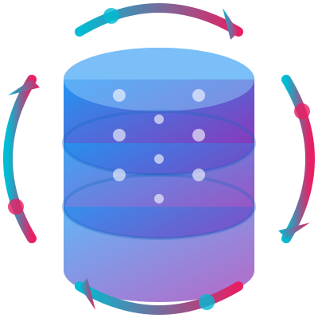

<p align="center">
  
</p>

<h1 align="center">Oracle 到 PolarDB PostgreSQL 企业级迁移平台</h1>

<p align="center">
  <strong>面向企业的 Oracle → 阿里云 PolarDB (PostgreSQL) 一站式迁移与同步解决方案</strong>
</p>

<p align="center">
  
  
  
  
  
</p>

---

## 📋 目录

- [产品概述](#-产品概述)
- [适用场景与版本](#-适用场景与版本)
- [核心功能](#-核心功能)
- [系统架构](#-系统架构)
- [快速开始](#-快速开始)
- [功能说明](#-功能说明)
- [开发指南](#-开发指南)
- [文档与支持](#-文档与支持)
- [许可证](#-许可证)

---

## 🎯 产品概述

**Oracle 到 PolarDB PostgreSQL 迁移平台** 是一套面向企业级场景的数据库迁移与数据同步解决方案，帮助客户将现有 Oracle 数据库（含 11g 及更高版本）的结构与数据，安全、可控地迁移至阿里云 PolarDB PostgreSQL 兼容引擎（PostgreSQL 15），并支持任务编排、进度监控、冲突策略与日志审计，满足合规与运维需求。

- **一站式**：从连接配置、对象选择、任务创建到执行与监控，全流程 Web 化操作。  
- **可扩展**：支持单对象、多对象及整库表批量迁移，适配不同迁移规模。  
- **可观测**：实时进度、明细日志、任务状态与失败诊断，便于排障与汇报。

---

## 📌 适用场景与版本

| 项目 | 说明 |
|------|------|
| **源端数据库** | Oracle Database 11g 及更高版本（如 11.2.0.4 等），支持表、视图、物化视图、存储过程/函数等对象 |
| **目标数据库** | 阿里云 PolarDB PostgreSQL 或兼容 PostgreSQL 15 的实例 |
| **典型场景** | 上云迁移、数据库替换、读写分离/只读实例数据同步、历史数据归档与离线分析（如 SQLite 导出） |

---

## ✨ 核心功能

### 🔗 连接与配置管理

- **Oracle 连接**：支持多套 Oracle 源库配置，连接测试与健康检查。  
- **PostgreSQL / PolarDB 连接**：支持多目标实例、多库、SSL 等配置，连接校验。  
- **任务级目标库**：创建任务时按三步选择目标 PolarDB：**① 选择数据库链接 → ② 选择目标数据库 → ③ 选择目标 Schema**，便于多库、多 Schema 分发；任务详情页会展示 PolarDB 连接名、目标数据库、目标 Schema 以及源端选择的表/视图列表。

### 📦 对象类型与迁移能力

| 功能模块 | 说明 |
|----------|------|
| **表 (Table)** | 迁移表结构（含类型映射）及全量数据；支持百万级大表分批读取与进度更新 |
| **视图 (View)** | 迁移视图定义至 PostgreSQL 等价语法（含常见 Oracle 函数/语法转换） |
| **视图数据迁移到表 (View→Table)** | 将视图查询结果物化到目标表，支持多视图批量、冲突策略与实时进度 |
| **物化视图 (Materialized View)** | 迁移物化视图定义及刷新逻辑 |
| **例程 (Routine)** | 迁移存储过程、函数等，并进行基础语法转换（如 NVL→COALESCE） |
| **所有表 (All Tables)** | 按 Schema 批量迁移该 Schema 下所有表，在当前任务中依次执行并显示进度（不创建子任务） |
| **视图数据迁移到 SQLite** | 将指定视图数据导出为本地 SQLite 文件，便于离线分析或归档 |

### ⚙️ 冲突与策略

- **冲突策略**：目标对象已存在时可选择 **报错 / 替换 / 跳过 / 追加 / 清空后重导**，按任务或对象粒度控制。  
- **标识符大小写**：支持 **小写 / 大写 / 保持原样**，避免目标库命名规范差异导致的引用错误。

### 📊 迁移监控与可观测性

- **实时进度**：任务级总进度 + 各对象（表/视图）明细进度，前端轮询展示。  
- **大表优化**：百万级行表/视图采用「先 COUNT 再分批迁移」策略，进度按真实行数更新，避免长时间显示 0%。  
- **节流写库**：进度约每 1% 或每 5 万行更新一次，兼顾体验与数据库压力。  
- **取消与安全**：支持运行中取消；取消后已写入数据保留，事务回滚，不影响后续任务。  
- **日志与诊断**：任务日志、对象级日志、错误堆栈与建议，便于排查与审计。

### 🔒 安全与多租户

- **认证**：支持 JWT 等认证方式，与现有企业身份体系集成。  
- **连接信息**：数据库密码等敏感信息存储与展示遵循最小化原则，可按企业策略扩展加密。

---

## 🏗 系统架构

```
┌─────────────────────────────────────────────────────────────────────────┐
│                            Web 前端 (Vue 3 + TypeScript + Vite)          │
│  任务列表 / 任务详情 / 连接管理 / 对象选择 / 进度与日志 / 系统配置        │
└─────────────────────────────────────────────────────────────────────────┘
                                        │
                                        ▼
┌─────────────────────────────────────────────────────────────────────────┐
│                         REST API (Django REST framework)                  │
│  认证、任务 CRUD、启动/取消、状态与进度、连接测试、库表/视图/例程枚举     │
└─────────────────────────────────────────────────────────────────────────┘
                                        │
                    ┌───────────────────┼───────────────────┐
                    ▼                   ▼                   ▼
┌──────────────────────┐  ┌──────────────────────┐  ┌──────────────────────┐
│   Oracle 源库         │  │   PostgreSQL/PolarDB │  │   本地 SQLite / 配置  │
│   (表/视图/例程/数据)  │  │   目标库（结构与数据） │  │   任务与日志存储      │
└──────────────────────┘  └──────────────────────┘  └──────────────────────┘
```

- **后端**：Django 5.x + Python 3.12，负责业务逻辑、调度、类型转换与进度持久化。  
- **前端**：Vue 3 + TypeScript + Vite，Bootstrap 5 样式，与后端 API 解耦，便于独立部署与定制。  
- **数据流**：Oracle 只读访问 → 应用层转换与分批写入 → PostgreSQL/PolarDB 或 SQLite。

---

## 🚀 快速开始

### 环境要求

| 类别 | 要求 |
|------|------|
| **运行环境** | Python 3.12+，Node.js 18+（前端构建） |
| **依赖** | Oracle 客户端与驱动（如 cx_Oracle）、PostgreSQL 驱动（如 psycopg2） |
| **包管理** | 后端推荐 `uv`，前端推荐 `pnpm` |

### 后端启动

```bash
# 安装依赖
uv pip install -r requirements.txt

# 数据库迁移（使用项目配置的 SQLite/PostgreSQL 等）
uv run manage.py migrate

# 创建超级用户（首次）
uv run manage.py createsuperuser

# 启动开发服务器
uv run manage.py runserver 0.0.0.0:8000
```

### 前端启动

```bash
cd frontend
pnpm install
pnpm dev
```

生产环境可将前端构建产物部署至 Nginx 等静态服务器，并配置 API 代理指向后端。

### 基本使用流程

1. **配置连接**：在「连接管理」中新增 Oracle 源连接与 PolarDB/PostgreSQL 目标连接，并执行连接测试。
2. **选择对象**：通过「创建任务」选择源 Schema、对象类型（表/视图/视图→表/例程等）及具体对象。
3. **创建任务**：选择目标 PolarDB 时依次完成「数据库链接 → 目标数据库 → 目标 Schema」，再设置冲突策略、标识符大小写等，保存任务。任务详情页可查看已选的 PolarDB 连接、目标数据库、目标 Schema 以及源表/视图列表。
4. **执行与监控**：在任务列表或详情页启动任务，查看实时进度与日志，必要时可取消。  
5. **结果校验**：在目标库中检查对象结构与数据，结合日志处理失败或部分成功项。

---

## 📖 功能说明

### 任务类型一览

| 类型 | 说明 | 典型用途 |
|------|------|----------|
| **表** | 单表结构 + 全量数据迁移 | 核心业务表迁移 |
| **视图** | 仅迁移视图定义 | 逻辑视图上云 |
| **视图数据迁移到表** | 将视图结果导入到目标表 | 物化视图数据、报表表 |
| **物化视图** | 物化视图定义与刷新 | 汇总层迁移 |
| **例程** | 存储过程、函数 | 业务逻辑迁移 |
| **所有表** | 按 Schema 批量建表任务 | 整库表结构+数据 |
| **视图数据迁移到 SQLite** | 导出为本地 SQLite 文件 | 归档、离线分析 |

### 冲突策略说明

- **报错**：目标已存在则任务失败，便于发现配置错误。  
- **替换**：删除已存在对象后重新创建（谨慎使用）。  
- **跳过**：已存在则跳过该对象，继续后续。  
- **追加**：仅追加数据（适用于表），不重建结构。  
- **清空后重导**：先 Truncate 再导入，适用于需要全量刷新的表。

### 大表与进度

- 单表或「视图→表」在迁移前会执行 `COUNT(*)` 获取总行数（大表可能略慢）。  
- 数据按批（如 5000 行/批）读取与写入，进度按「已迁移行数/总行数」更新并节流持久化。  
- 详见 [迁移进度与监控](docs/迁移进度与监控.md)。

---

## 🔧 开发指南

### 后端技术栈

- **Python 3.12** · **Django 5.2** · **Django REST framework** · **SimpleUI**（可选管理后台）  
- **cx_Oracle** · **psycopg2** · **JWT 认证**

### 前端技术栈

- **Vue 3** · **TypeScript** · **Vite** · **Bootstrap 5** · **Vue Router** · **Pinia**（可选）

### 前端常用命令

```bash
cd frontend
pnpm install    # 安装依赖（推荐使用 pnpm）
pnpm dev       # 开发模式
pnpm build     # 生产构建
```

### 为什么使用 pnpm？

pnpm 在安装速度、磁盘占用与依赖一致性方面表现更好，本项目推荐使用 pnpm 管理前端依赖。

### 为什么使用 Django？

Django 提供成熟的 ORM、Admin、安全与扩展生态，适合快速构建稳定、可维护的 REST API 与迁移调度服务。

---

## 📚 文档与支持

| 文档 | 说明 |
|------|------|
| [文档索引](docs/文档索引.md) | 所有说明文档的集中索引与阅读建议 |
| [迁移进度与监控](docs/迁移进度与监控.md) | 进度计算方式、大表优化、接口说明与注意事项 |
| [路由与前后端配置](docs/路由与前后端配置.md) | 前后端路由、API 端点、开发/生产部署与常见问题 |
| [颜色系统使用说明](docs/颜色系统使用说明.md) | 主题与 CSS 变量、Bootstrap 集成、pnpm/uv 使用与启动流程 |
| [需求与版本说明](docs/需求与版本说明.md) | 项目背景、适用 Oracle/PolarDB 版本及技术栈 |
| 本 README | 产品概述、功能说明、快速开始与开发指南 |

更多说明可查看项目内 `docs/` 目录及代码注释。

---

## 📄 许可证

© 2025 Oracle 到 PolarDB 迁移工具 · 版权所有

---

<p align="center">
  
</p>
<p align="center">
  <sub>Oracle → PolarDB PostgreSQL 企业级迁移平台</sub>
</p>
