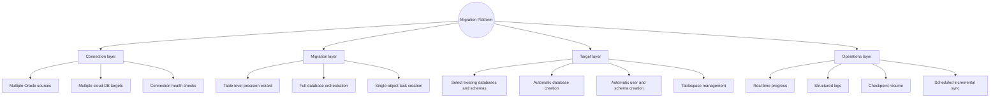
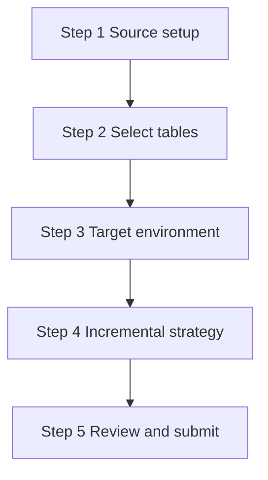
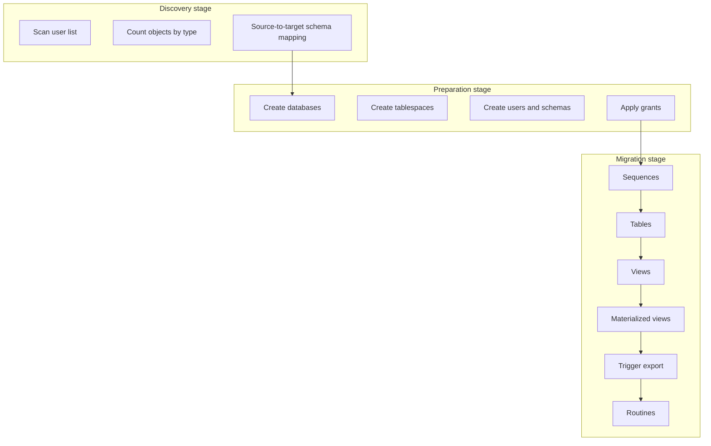
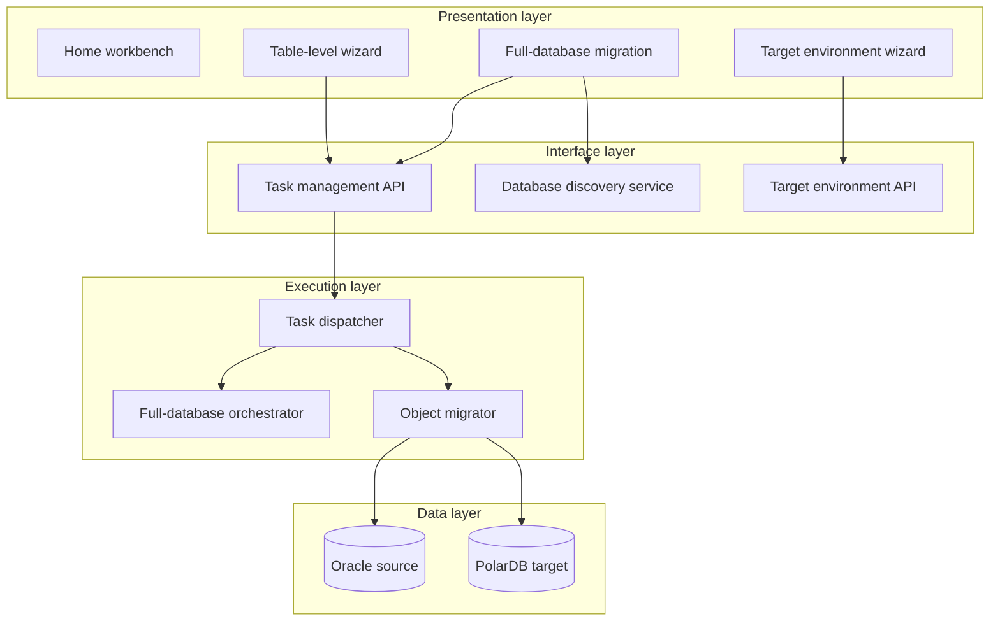
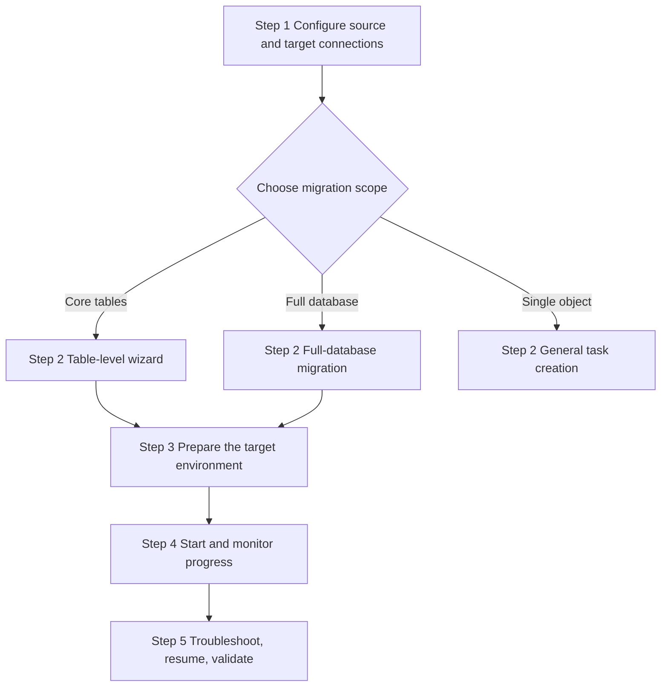

<!-- Documentation version: v2.4.3 · enterprise migration platform -->


</br>
<h1 align="center">Oracle to PolarDB PostgreSQL</h1>

<p align="center">English | <a href="./README.md">中文</a></p>

<h3 align="center">Enterprise Database Migration &amp; Synchronization Platform</h3>

<p align="center">
  
  
  
</p>

<p align="center">
  <strong>One-stop cloud migration · table-level precision migration · full-database orchestration · automatically ready target environment</strong>
</p>

<p align="center">
  <sub>Migrate the structure and data of Oracle 11g+ to PolarDB for PostgreSQL safely and under control · supports incremental sync and checkpoint resume</sub>
</p>

<br/>

<p align="center">
  <a href="#-quick-start"></a>
  &nbsp;
  <a href="#-highlights--v2"></a>
  &nbsp;
  <a href="#-system-architecture"></a>
  &nbsp;
  <a href="docs/文档索引.md"></a>
</p>

<br/>

<p align="center">
  
  
  
  
</p>

<p align="center">
  
  
  
  
  
</p>

<br/>

<!-- Core capabilities at a glance -->
<table align="center">
  <tr>
    <td align="center" width="25%">
      <h4>📋 Table-level migration wizard</h4>
      <sub>Pick tables · incremental sync · target environment setup</sub>
    </td>
    <td align="center" width="25%">
      <h4>☁️ One-click full-database migration</h4>
      <sub>Multi-schema · all-object orchestration · staged progress</sub>
    </td>
    <td align="center" width="25%">
      <h4>🛠 Target environment DDL</h4>
      <sub>Database · tablespaces · users · schemas</sub>
    </td>
    <td align="center" width="25%">
      <h4>📡 Real-time monitoring</h4>
      <sub>Progress polling · log audit · primary-key comparison</sub>
    </td>
  </tr>
</table>

<br/>

<!-- Platform core metrics -->
<table align="center">
  <tr>
    <td align="center"><strong>11+</strong><br/><sub>object types migrated</sub></td>
    <td align="center"><strong>5</strong><br/><sub>table-level wizard steps</sub></td>
    <td align="center"><strong>6</strong><br/><sub>full-database orchestration stages</sub></td>
    <td align="center"><strong>3</strong><br/><sub>incremental sync modes</sub></td>
    <td align="center"><strong>∞</strong><br/><sub>checkpoint resume support</sub></td>
  </tr>
</table>

<br/>

---

## 📋 Table of Contents

> [!TIP]
> Suggested reading order for first-time readers: **Product Overview** → **Quick trial (Docker)** → **v2 Highlights** → **User Guide**

<details open>
<summary><b>📂 Expand full navigation</b></summary>

<br/>

| Section | Description |
|:--------|:------------|
| [🎯 Product Overview](#-product-overview) | Platform positioning and core capability matrix |
| [⚡ Quick trial (Docker, no build)](#-quick-trial-docker-no-build) | Pull the CI image; three commands to a running service |
| [✨ Highlights · v2](#-highlights--v2) | Table-level wizard · full-database orchestration · target environment DDL |
| [🆕 Release highlights (v2.1 – v2.4.3)](#release-highlights-v21--v243) | Condensed changelog: logging · security hardening · migration correctness · syntax compatibility |
| [📌 Supported Scenarios & Versions](#-supported-scenarios--versions) | Source/target versions and typical scenarios |
| [✨ Core Feature Matrix](#-core-feature-matrix) | Connections, objects, strategies, observability |
| [🏗 System Architecture](#-system-architecture) | Frontend/backend layering and data flow |
| [🗺 Navigation and Route Map](#-navigation-and-route-map) | Menu and route reference table |
| [🚀 Quick Start](#-quick-start) | Requirements and one-command startup |
| [📖 User Guide](#-user-guide) | Three onboarding paths and strategy cheat sheet |
| [🔌 API Quick Reference · New](#-api-quick-reference--new) | REST endpoints added in v2 |
| [🔧 Development Guide](#-development-guide) | Tech stack and key modules |
| [🐳 Docker Deployment](#-docker-deployment) | Single image · prebuilt image addresses · one-command compose deploy |
| [❓ FAQ](#-faq) | Troubleshooting and error diagnosis |
| [📚 Documentation & Support](#-documentation--support) | Sub-document index |
| [📄 License](#-license) | Copyright information |

</details>

---

## 🎯 Product Overview

The **Oracle to PolarDB PostgreSQL migration platform** is a database migration and data synchronization solution for enterprise scenarios. It helps customers migrate the structure and data of Oracle 11g and later to Alibaba Cloud PolarDB for PostgreSQL (Oracle-compatibility engine) safely and under control, with **task orchestration, target environment provisioning, incremental sync, checkpoint resume**, and end-to-end observability. This kind of "Oracle-exit (去O)" program is the platform's core use case.



<br/>

<table>
  <thead>
    <tr>
      <th align="center" width="18%">Capability</th>
      <th>Description</th>
      <th align="center" width="12%">Maturity</th>
    </tr>
  </thead>
  <tbody>
    <tr>
      <td align="center"><strong>One-stop</strong></td>
      <td>Connection setup → object selection → target ready → execution monitoring, fully web-based</td>
      <td align="center">✅ Production</td>
    </tr>
    <tr>
      <td align="center"><strong>Orchestrable</strong></td>
      <td>Single table, multiple tables, full schema, <strong>multiple schemas across an instance</strong> — migration at multiple granularities</td>
      <td align="center">✅ Production</td>
    </tr>
    <tr>
      <td align="center"><strong>Incremental</strong></td>
      <td>Watermark-column appends, primary-key alignment with scheduled inserts/deletes, powered by Celery Beat</td>
      <td align="center">✅ Production</td>
    </tr>
    <tr>
      <td align="center"><strong>Observable</strong></td>
      <td>Three-level progress (task/object/stage), log audit and failure diagnosis</td>
      <td align="center">✅ Production</td>
    </tr>
    <tr>
      <td align="center"><strong>Resumable</strong></td>
      <td>Large tables, multi-table batches and full-database orchestration all support checkpoint recovery</td>
      <td align="center">✅ Production</td>
    </tr>
  </tbody>
</table>

---

## ⚡ Quick trial (Docker, no build)

No Python/Node toolchain, no local image build — pull the CI artifact and run the platform:

```bash
# 1) Runtime config: the image ships no secrets; the container refuses to start without these
cat > .env <<'EOF'
DJANGO_ENV=prod
DJANGO_DEBUG=false
DJANGO_SECRET_KEY=trial-please-change-me
MIGRATION_FERNET_KEY=trial-fernet-please-change-me
ALLOWED_HOSTS=localhost,127.0.0.1
SECURE_SSL_REDIRECT=false
EOF

# 2) Pull the image and start the container (SPA + API same-origin, port 8000 only)
docker pull registry.cn-hangzhou.aliyuncs.com/hayrat/oracle2polardb_pg:latest
docker run -d --name o2p -p 8000:8000 --env-file .env \
  registry.cn-hangzhou.aliyuncs.com/hayrat/oracle2polardb_pg:latest

# 3) Create tables + an account, then open http://localhost:8000
docker exec o2p python manage.py migrate --noinput
docker exec -it o2p python manage.py createsuperuser
```

If ACR is unreachable, pull from GHCR instead (also anonymous): `ghcr.io/hayratjan/oracle2polardb_pg:latest`.

This `.env` is only for a local trial and is already covered by `.gitignore` — **never commit it**, and replace both secrets with random values before going live.

Three traps that always show up as "it won't start":

| Symptom | Cause | Fix |
|:--------|:------|:----|
| Container restarts in a loop; log says `生产环境必须通过 … 提供密钥` | Any of `DJANGO_SECRET_KEY` / `MIGRATION_FERNET_KEY` / `ALLOWED_HOSTS` is empty (`.env.example` ships `MIGRATION_FERNET_KEY=` blank) | Set all three to non-empty values; the Fernet key accepts any string (SHA-256 derived internally) — use a random secret in production |
| Home page 301-redirects to `https://` and then fails | Production defaults `SECURE_SSL_REDIRECT` to on, but the container only listens on 8000 | `SECURE_SSL_REDIRECT=false` (turn it back on behind a TLS-terminating proxy) |
| `docker pull` fails with `no matching manifest for linux/arm64` | Both registries publish only `linux/amd64` | Add `--platform linux/amd64`; emulated on Apple Silicon — works, just slower |

- Source database is **Oracle 11g (11.2.0.4)**: switch the tag to `:latest-thick` (Instant Client built in); the `thin` variant cannot reach old versions.
- A single container runs Web + API only. **Full-database orchestration and scheduled incremental sync need Redis + Celery** — use the compose stack (override file below in [🐳 Docker Deployment](#-docker-deployment)):
  ```bash
  C="-f docker-compose.yml -f docker-compose.prebuilt.yml"
  docker compose $C pull && docker compose $C up -d
  ```
- Without a data volume, metadata lives in the container's `db.sqlite3` and disappears with `docker rm`; point `DATABASE_URL` at PolarDB/PostgreSQL for real deployments.
- To modify code and build locally instead: [🚀 Quick Start](#-quick-start) and [🐳 Docker Deployment](#-docker-deployment).

---

## ✨ Highlights · v2

> [!IMPORTANT]
> This release ships: **table-level migration wizard** · **one-click full-database migration** · **automatic PolarDB target environment DDL provisioning**

<br/>

<table>
  <tr>
    <td width="33%" valign="top">
      <h4>📋 Table-level migration wizard</h4>
      <code>/task/table-migrate</code><br/><br/>
      A five-step wizard that converges table selection, target setup, and incremental strategy into one path — suited to phased cloud migration of core business tables.
    </td>
    <td width="33%" valign="top">
      <h4>☁️ One-click full-database migration</h4>
      <code>/migration/full-database</code><br/><br/>
      Automatically discovers multiple schemas and orchestrates sequences → tables → views → routines in dependency order.
    </td>
    <td width="33%" valign="top">
      <h4>🛠 Target environment DDL</h4>
      <code>TargetEnvWizard</code><br/><br/>
      One-click database/tablespace/user/schema creation from the web UI — no more repeated console logins.
    </td>
  </tr>
</table>

<br/>

### 📋 Table-level migration wizard

**Entry**: sidebar `Migration Management → Table-level Migration` · route `/task/table-migrate`

A five-step wizard that folds "pick tables + configure target + define increment" into one clear path:



| Step | Capability | Description |
|:----:|:-----------|:------------|
| ① | Source | Select the Oracle connection and schema; the table list loads automatically |
| ② | Table selection | `TABLE` type only, with search, select-all, and batch selection |
| ③ | Target | Reuses `TargetEnvWizard`: pick existing or **create** database/tablespace/user/schema |
| ④ | Incremental | `none` full load · `timestamp` watermark column · `pk_mirror` primary-key alignment + schedule |
| ⑤ | Submit | Optionally run `prepare_target` DDL first, then create a `table` type task |

> [!NOTE]
> **Typical scenario**: migrating core business tables to the cloud in batches, per-table incremental sync, or when the target database has not yet been created manually in the PolarDB console.

---

### ☁️ One-click full-database migration

**Entry**: sidebar `Migration Management → Full-database Migration` · route `/migration/full-database`

Under a single Oracle connection, all non-system schemas are discovered automatically and migrated in dependency order:



| Orchestration stage | Behavior | Resume |
|:-------------------:|:---------|:------:|
| Prepare environment | Creates databases/users/schemas per wizard configuration | — |
| Sequences | All schemas' sequences created first | ✅ |
| Tables | Per schema, per table: structure + data migration | ✅ |
| Views | Materialize to tables or create view definitions (reuses existing `migrate_view`) | ✅ |
| Materialized views | MV definitions and data | ✅ |
| Triggers | **Exports source-code templates**; no automatic DDL execution | ✅ |
| Routines | Basic syntax conversion of stored procedures/functions | ✅ |

The task detail page shows a **multi-stage progress bar**, the current schema, and completed/failed object lists, with a "continue migration" button for checkpoint resume.

---

### 🛠 Automatic target environment provisioning

The `TargetEnvWizard` component plus the backend `target_provisioning` module prepare the PolarDB-side environment from the web UI, without repeated console logins:

```
┌─────────────────────────────────────────────────────────────────┐
│  TargetEnvWizard · target environment panel                      │
├─────────────────────────────────────────────────────────────────┤
│  📦 Database   [ select existing ▼ ] [ create ▼ ]  name · UTF8   │
│  💾 Tablespace [ default ▼ ] [ existing ▼ ] [ create + LOCATION ]│
│  👤 User       [ skip ▼ ] [ existing ▼ ] [ create + pwd + CREATEDB│
│  📂 Schema     [ existing public ▼ ] [ create + owner ]          │
├─────────────────────────────────────────────────────────────────┤
│  [ 🔧 Test and prepare environment ]  →  POST /api/target-env/prepare/ │
└─────────────────────────────────────────────────────────────────┘
```

| Resource | Modes | Privilege requirement |
|:---------|:------|:--------------------|
| Database | `existing` / `create` / `skip` | `CREATEDB` or superuser |
| Tablespace | `skip` / `existing` / `create` | Superuser + server-side directory path |
| User | `skip` / `existing` / `create` | `CREATEROLE` or superuser |
| Schema | `existing` / `create` | `CREATE` privilege on the target database |

> [!WARNING]
> Creating a tablespace requires a filesystem path on the PolarDB instance; without superuser privileges, fall back to "use the default tablespace" and provision only the database/user/schema.

---

## Release highlights (v2.1 – v2.4.3)

Details for each fix are tracked in the Chinese README and `docs/`; the per-item changelog is not duplicated here.

### 🆕 v2.1 — [优化与修复](./README.md#-v21-优化与修复)

- Unified structured log protocol: 8 levels (`STEP`/`INFO`/`OK`/`WARN`/`ERROR`/`DATA`/`SQL`/`META`) called consistently by all migration modules; the frontend log panel colors by level with filtering, search, auto-scroll, and copy/download.
- Transaction-abort protection: each object's failure path rolls back before re-raising so one bad object no longer cascades; identical errors are grouped into one root cause + count instead of thousands of duplicate log lines.
- bigint range clamping: Oracle sequence `MAX_VALUE`/`MIN_VALUE`/`LAST_NUMBER` beyond the PostgreSQL bigint limit are truncated to bigint bounds, with the original value noted in the log.
- Connection timeout control: `call_timeout_ms` (default 30 s) per SQL, a 90 s overall timeout on instance discovery, discovery queries batched via `GROUP BY` (10N round-trips → 7), and timeouts surfaced as HTTP 504.
- Object-selection UI redesigned (card grids, improved task-creation lists, terminal-style log panel) and a `task.source_object` persistence fix for the view/materialized-view/routine stages.

### 🆕 v2.2 — [企业级加固](./README.md#-v22-企业级加固)

- P0 security hardening: dev/prod separation (`DJANGO_ENV`), enforced `SECRET_KEY`/`ALLOWED_HOSTS`/CORS whitelist, security headers (SSL redirect/HSTS/secure cookies/`X_FRAME_OPTIONS=DENY`), DRF rate limiting, directory-browse sandbox against path traversal, non-leaking error responses, `/healthz` + `/readyz` probes, independent `JWT_SIGNING_KEY`, `DATABASE_URL` support for a PostgreSQL metadata database, Redis cache, and structured `LOGGING`.
- Ops management commands: `init_admin`, `cleanup_logs`, `reconcile_running`, `healthcheck`.
- Data type coverage extended from 17 to 24 Oracle types (XMLTYPE, ROWID/UROWID, BFILE, INTERVAL, BOOLEAN, …).
- Unsupported-index warnings: function-based, bitmap, and reverse-key indexes are counted at migration time with PG equivalents (expression index / GIN / plain B-tree).
- Table/column comment migration via `ALL_TAB_COMMENTS` / `ALL_COL_COMMENTS` and `COMMENT ON ...`.
- Validation upgraded from row counts only to a 4-layer system (row counts, aggregates, per-primary-key MD5 hashes, random sampling) plus a combined `validate_full`.

### 🆕 v2.3 – v2.4.3 — [迁移正确性与语法兼容](./README.md#-v23--v243-迁移正确性与语法兼容)

- v2.4: read-only database comparison preview (rows to insert/delete/coexist before any write) and immediate incremental sync — primary-key set difference (INSERT/DELETE on target, hash-compare coexisting rows for UPDATE replay) and watermark-column increments scheduled by Celery Beat.
- Driver migrated from `cx_Oracle` to `python-oracledb` (thin mode, no Instant Client needed), which also fixed CI builds.
- SQL syntax compatibility strengthened: DECODE → CASE WHEN (nesting-aware paren balancing), NVL2, LISTAGG → STRING_AGG, TO_DATE/TO_CHAR/TO_NUMBER, EXECUTE IMMEDIATE, DBMS_OUTPUT, plus a 13-category Oracle-specific-syntax manual review checklist.
- Tauri cross-platform desktop client packaging.
- 13 P0/P1/P2 correctness fixes in v2.4.2/v2.4.3, including: `view_progress` overwritten during full-database runs (broke resume), multi-byte BLOB corruption through the COPY `\xNN` escape path, identity/sequence `setval` alignment to `MAX(col)` after data load, `ROWNUM <= N` rewritten to `FETCH FIRST`, typed hash expressions (numeric columns hit ORA-01481, silently breaking incremental UPDATE detection), LOB decode failures now raise by default (`LOB_ERROR_POLICY`) instead of storing NULL, `validate_full` wired into the main single-table flow, export-only objects (trigger templates, incompatible routines) downgraded to `partial` at terminal state, and trigger-template statement-level WHEN clauses validated for NEW/OLD references.
- DDL injection hardening: CREATE/DROP of views, materialized views, tables, sequences, schemas, TRUNCATE, and `search_path` now compose identifiers with `psycopg2.sql.Identifier` instead of f-string SQL.

---

## 📌 Supported Scenarios & Versions

<table>
  <thead>
    <tr>
      <th width="18%">Dimension</th>
      <th>Description</th>
      <th width="14%">Recommendation</th>
    </tr>
  </thead>
  <tbody>
    <tr>
      <td><strong>Source</strong></td>
      <td>Oracle Database <strong>11g+</strong> (e.g. 11.2.0.4 Enterprise Edition); schema = <code>ALL_USERS.USERNAME</code></td>
      <td>⭐⭐⭐⭐⭐</td>
    </tr>
    <tr>
      <td><strong>Target</strong></td>
      <td>Alibaba Cloud <strong>PolarDB for PostgreSQL</strong> or any PostgreSQL 15-compatible instance</td>
      <td>⭐⭐⭐⭐⭐</td>
    </tr>
    <tr>
      <td><strong>Precision migration</strong></td>
      <td>Per-table selection, incremental sync, target database/user/schema not yet provisioned</td>
      <td>⭐⭐⭐⭐</td>
    </tr>
    <tr>
      <td><strong>Full-database scenario</strong></td>
      <td>Multiple schemas on one instance, all object types orchestrated in one run</td>
      <td>⭐⭐⭐⭐</td>
    </tr>
    <tr>
      <td><strong>Archive scenario</strong></td>
      <td>View data exported to SQLite for offline analysis</td>
      <td>⭐⭐⭐</td>
    </tr>
  </tbody>
</table>

---

## ✨ Core Feature Matrix

### 🔗 Connections & configuration

| Module | Capability | Tag |
|:-------|:-----------|:----|
| Oracle connections | Multi-source CRUD, connection test, schema/user/object enumeration | `source` |
| PolarDB connections | Multi-instance, SSL, database listing, schema/user/tablespace queries | `target` |
| Task-level target | Connection → database → schema three-step selection; target switchable at runtime | `orchestration` |
| Global policies | Default case handling, conflict strategy, batch size (system configuration page) | `strategy` |

### 📦 Object migration capabilities

| Type | Identifier | Description | Since |
|:-----|:-----------|:------------|:-----:|
| Table | `table` | Structure + data + constraints + indexes; multi-table single task, incremental, row-count validation | — |
| View | `view` | Materialized to a table, or created as a view definition (basic NVL/SYSDATE conversion) | — |
| Materialized view | `materialized_view` | MV definition and refresh logic | — |
| Sequence | `sequence` | Created before tables to guarantee auto-increment keys | — |
| Trigger | `trigger` | Exports Oracle source + PL/pgSQL template (manual rewrite) | — |
| Routine | `routine` | Basic syntax conversion of stored procedures/functions | — |
| All tables | `all_tables` | Full-table batch per schema with FK topological ordering | — |
| Full schema | `full_schema` | Sequences + all tables orchestrated | — |
| **Full database** | `full_database` | Multi-schema · all object types orchestrated | 🆕 |
| **Table batch** | `table_batch` | Batch table task created by the wizard (reuses multi-table logic) | 🆕 |
| SQLite export | `view_to_sqlite` | View data landed into a local SQLite file | — |

### ⚙️ Strategies & incremental sync

<table>
  <thead>
    <tr>
      <th width="22%">Strategy category</th>
      <th>Options</th>
    </tr>
  </thead>
  <tbody>
    <tr>
      <td><strong>Conflict strategy</strong></td>
      <td><code>error</code> · <code>replace</code> · <code>skip</code> · <code>append</code> · <code>truncate</code></td>
    </tr>
    <tr>
      <td><strong>Identifier case</strong></td>
      <td><code>lower</code> · <code>upper</code> · <code>preserve</code></td>
    </tr>
    <tr>
      <td><strong>Incremental mode</strong></td>
      <td><code>none</code> full load · <code>timestamp</code> watermark column · <code>pk_mirror</code> primary-key alignment</td>
    </tr>
    <tr>
      <td><strong>Scheduled sync</strong></td>
      <td>Celery Beat with configurable minimum interval (minute granularity)</td>
    </tr>
  </tbody>
</table>

### 📊 Observability

```
Task total progress ───────────────────────────────────────── 100%
  ├─ Object/table-level progress ────────────────────────────  85%
  │    └─ Row-level progress (COUNT + batched writes) ───────  72%
  └─ Full-database stage bar: prepare → sequences → tables → views → triggers → routines
```

- **Three-level progress**: task total → object/table level → row level (COUNT on large tables + batched writes)
- **Full-database stage bar**: prepare → sequences → tables → views → triggers → routines
- **Checkpoint resume**: `all_tables` · `table` · `full_schema` · `full_database` · `table_batch`
- **Primary-key comparison**: the monitoring page shows source/target row-count difference snapshots

---

## 🏗 System Architecture



<br/>

<table>
  <tr>
    <th width="20%">Layer</th>
    <th>Responsibility</th>
    <th width="28%">Key technologies</th>
  </tr>
  <tr>
    <td><strong>Presentation</strong></td>
    <td>Vue 3 SPA · sidebar navigation · theme switching · step-bar wizards · stage progress bars</td>
    <td>Vue Router · Pinia · Bootstrap 5</td>
  </tr>
  <tr>
    <td><strong>Interface</strong></td>
    <td><code>/api/tasks</code> · <code>/api/create-table-migration</code> · <code>/api/target-env/...</code></td>
    <td>DRF · JWT · CORS</td>
  </tr>
  <tr>
    <td><strong>Domain</strong></td>
    <td>Task model · target configuration JSON · orchestration state <code>view_progress</code></td>
    <td>Django ORM · JSONField</td>
  </tr>
  <tr>
      <td><strong>Execution</strong></td>
      <td>Celery workers / thread pool · batched read/write · type mapping · constraint replay</td>
      <td>Celery · python-oracledb · psycopg2</td>
    </tr>
    <tr>
      <td><strong>Data</strong></td>
      <td>Oracle (python-oracledb) ──► PolarDB (psycopg2) / SQLite</td>
    <td>Connection pool · credential encryption</td>
  </tr>
</table>

---

## 🗺 Navigation and Route Map

<table>
  <thead>
    <tr>
      <th>Group</th>
      <th>Menu</th>
      <th>Route</th>
      <th>Description</th>
      <th>Tag</th>
    </tr>
  </thead>
  <tbody>
    <tr><td rowspan="1">Workbench</td><td>Home</td><td><code>/</code></td><td>Stat cards · quick entries · recent tasks</td><td>—</td></tr>
    <tr><td rowspan="5">Migration Management</td><td>Migration tasks</td><td><code>/tasks</code></td><td>Paginated list · batch start/stop</td><td>—</td></tr>
    <tr><td>Real-time monitor</td><td><code>/monitor</code></td><td>Running tasks · logs · primary-key comparison</td><td>—</td></tr>
    <tr><td>Create task</td><td><code>/task/create</code></td><td>General multi-type task creation</td><td>—</td></tr>
    <tr><td><strong>Table-level migration</strong></td><td><code>/task/table-migrate</code></td><td>Five-step wizard · target environment · incremental</td><td>🆕 v2</td></tr>
    <tr><td><strong>Full-database migration</strong></td><td><code>/migration/full-database</code></td><td>Discovery · mapping · one-click orchestration</td><td>🆕 v2</td></tr>
    <tr><td rowspan="2">Connections</td><td>Oracle database</td><td><code>/oracle</code></td><td>Source connection CRUD · schema browsing</td><td>—</td></tr>
    <tr><td>PolarDB-PG</td><td><code>/postgres</code></td><td>Target connection CRUD · database/schema browsing</td><td>—</td></tr>
    <tr><td>System</td><td>System configuration</td><td><code>/config</code></td><td>Migration strategies · system parameters</td><td>—</td></tr>
    <tr><td>—</td><td>Task detail</td><td><code>/task/:id</code></td><td>Progress · logs · resume · stage bar</td><td>—</td></tr>
  </tbody>
</table>

---

## 🚀 Quick Start

### Requirements

<table>
  <thead>
    <tr>
      <th width="18%">Category</th>
      <th>Requirement</th>
      <th width="14%">Mandatory</th>
    </tr>
  </thead>
  <tbody>
    <tr>
      <td><strong>Runtime</strong></td>
      <td>Python 3.12+ · Node.js 18+</td>
      <td>✅</td>
    </tr>
    <tr>
      <td><strong>Database drivers</strong></td>
      <td>python-oracledb (Oracle, since v2.5; thin mode needs no client) · psycopg2 (PostgreSQL/PolarDB)</td>
      <td>✅</td>
    </tr>
    <tr>
      <td><strong>Oracle client</strong></td>
      <td>No Instant Client needed (oracledb thin mode); only thick-mode features require a 19c+ client</td>
      <td>Optional</td>
    </tr>
    <tr>
      <td><strong>Async tasks</strong></td>
      <td>Redis + Celery (async tasks and scheduled incremental sync in production)</td>
      <td>Optional</td>
    </tr>
    <tr>
      <td><strong>Package managers</strong></td>
      <td>Backend <code>uv</code> · frontend <code>pnpm</code></td>
      <td>✅</td>
    </tr>
  </tbody>
</table>

### Environment variables

Copy `.env.example` to `.env` and adjust as needed:

```bash
cp .env.example .env
```

| Variable | Description | Example |
|:---------|:------------|:--------|
| `DJANGO_SECRET_KEY` | Django secret key (must change in production) | random long string |
| `DJANGO_DEBUG` | Debug mode (set `false` in production) | `false` |
| `MIGRATION_FERNET_KEY` | Key for encrypting connection passwords | generated via `Fernet.generate_key()` |
| `ORACLE_CLIENT_LIB` | Oracle Instant Client path | `/opt/instantclient_23_3` |
| `CELERY_BROKER_URL` | Celery message queue | `redis://127.0.0.1:6379/0` |
| `CELERY_RESULT_BACKEND` | Celery result backend | `redis://127.0.0.1:6379/0` |
| `MIGRATION_BEAT_SCAN_SECONDS` | Scheduled incremental scan interval | `300` |

> [!WARNING]
> `MIGRATION_FERNET_KEY` encrypts stored database connection passwords and **must be generated and configured before the first deployment**, otherwise saved connections cannot be decrypted. Generate it with:
> ```bash
> python -c "from cryptography.fernet import Fernet; print(Fernet.generate_key().decode())"
> ```

### Option 1: one-click start script (recommended)

The project ships one-click start scripts that bring up both frontend and backend dev servers:

```bash
# macOS / Linux
./start_dev.sh --migrate --install

# Windows
.\start_dev.ps1 -Migrate -Install

# Start Celery Worker + Beat (requires CELERY_BROKER_URL configured first)
CELERY_BROKER_URL=redis://127.0.0.1:6379/0 ./start_dev.sh --celery --beat
```

| Flag | Description |
|:-----|:------------|
| `--migrate` | Run `uv run manage.py migrate` before starting |
| `--install` | Install backend and frontend dependencies |
| `--celery` | Start the Celery worker (requires `CELERY_BROKER_URL`) |
| `--beat` | Start Celery Beat (required for scheduled incremental sync; combine with `--celery`) |

After startup:
- Frontend: http://localhost:5173
- Backend API: http://localhost:8000

### Option 2: manual start

```bash
# ══════════════════════════════════════════════
#  Backend · Django REST API
# ══════════════════════════════════════════════
uv pip install -r requirements.txt
uv run manage.py migrate          # includes new fields such as target_provisioning
uv run manage.py createsuperuser  # first deployment
uv run manage.py runserver 0.0.0.0:8000

# ══════════════════════════════════════════════
#  Frontend · Vue 3 SPA
# ══════════════════════════════════════════════
cd frontend && pnpm install && pnpm dev
# → http://localhost:5173
```

> [!TIP]
> In production, run the Celery worker and Beat together to support background tasks and scheduled incremental sync.

### Recommended onboarding path



---

## 📖 User Guide

<table>
  <tr>
    <th width="28%">Path</th>
    <th>Typical scenario</th>
    <th>Entry</th>
  </tr>
  <tr>
    <td><strong>Path A · Table-level wizard</strong></td>
    <td>Per-table precision migration, incremental sync, target environment not yet provisioned</td>
    <td><code>/task/table-migrate</code></td>
  </tr>
  <tr>
    <td><strong>Path B · Full-database migration</strong></td>
    <td>Multiple schemas on one instance, orchestration across all object types</td>
    <td><code>/migration/full-database</code></td>
  </tr>
  <tr>
    <td><strong>Path C · General task creation</strong></td>
    <td>Views, routines, single sequences, SQLite export</td>
    <td><code>/task/create</code></td>
  </tr>
</table>

<br/>

<details>
<summary><b>📋 Path A · Table-level wizard (expand steps)</b></summary>

<br/>

1. Open **Table-level Migration** and select the Oracle connection and source schema.
2. Tick the tables to migrate (search and select-all supported).
3. In the **Target environment** panel select the PolarDB connection, optionally **create the database/user/schema**, then click "Test and prepare environment".
4. Configure the incremental mode (optionally a watermark column, or primary-key alignment + schedule).
5. Confirm to create the task, start it from the detail page, and watch multi-table progress.

</details>

<details>
<summary><b>☁️ Path B · Full-database migration (expand steps)</b></summary>

<br/>

1. Open **Full-database Migration**, select the Oracle connection, and click **Refresh discovery**.
2. Review per-schema object statistics and edit the **Oracle schema → target schema** mappings.
3. Configure the PolarDB target environment and tick the object types to migrate (all selected by default).
4. Click **Create and start immediately**, then follow the stage progress bar on the detail page.
5. After the trigger stage completes, copy the PL/pgSQL templates from the log, rewrite them manually, and execute them on the target.

</details>

<br/>

### Conflict strategy quick reference

| Strategy | Behavior | Suitable for | Risk |
|:---------|:---------|:-------------|:----:|
| `error` | Fail if the object already exists | First migration runs, strict validation | Low |
| `replace` | Drop and recreate | Structural changes that must take effect | Medium |
| `skip` | Skip objects that already exist | Incremental catch-up migration | Low |
| `append` | Append data only | Incremental sync (required for primary-key alignment) | Medium |
| `truncate` | Truncate then reload | Periodic full refresh | High |

---

## 🔌 API Quick Reference · New

> [!IMPORTANT]
> All APIs require JWT authentication. Credentials are stored Fernet-encrypted; never log plaintext passwords.

<details>
<summary><b>Expand full list of new endpoints</b></summary>

<br/>

| Method | Endpoint | Description | Scenario |
|:-------|:---------|:------------|:---------|
| `GET` | `/api/oracle/discovery/?connection_id=` | Full-database schema and object statistics | Full-database discovery |
| `POST` | `/api/create-table-migration/` | Create task from the table-level wizard | Table-level precision migration |
| `POST` | `/api/create-full-database-migration/` | Create full-database orchestration task | Full-database orchestration |
| `POST` | `/api/target-env/prepare/` | Prepare the target environment in one call | DDL provisioning |
| `GET` | `/api/polardb/tablespaces/?connection_id=` | List tablespaces | Target configuration |
| `POST` | `/api/polardb/databases/create/` | Create a database | DDL |
| `POST` | `/api/polardb/tablespaces/create/` | Create a tablespace | DDL |
| `POST` | `/api/polardb/users/create/` | Create a user/role | DDL |
| `POST` | `/api/polardb/schemas/create/` | Create a schema | DDL |

<br/>

**`target_provisioning` configuration example** (stored in `MigrationTask.target_provisioning`):

```json
{
  "database": { "mode": "create", "name": "appdb", "encoding": "UTF8" },
  "tablespace": { "mode": "skip" },
  "user": { "mode": "create", "username": "app", "password": "***" },
  "schema": { "mode": "create", "name": "app_schema", "owner": "app" },
  "schema_mappings": [
    { "source_schema": "HR", "target_schema": "hr" }
  ],
  "object_types": {
    "sequences": true, "tables": true, "views": true,
    "materialized_views": true, "triggers": true, "routines": true
  }
}
```

</details>

---

## 🔧 Development Guide

### Tech stack

<table>
  <thead>
    <tr>
      <th width="50%">Backend</th>
      <th>Frontend</th>
    </tr>
  </thead>
  <tbody>
    <tr>
      <td valign="top">
        <ul>
          <li>Python 3.12 · Django 5.2 · DRF</li>
          <li>python-oracledb · psycopg2 · Celery</li>
          <li>JWT · Fernet credential encryption</li>
        </ul>
      </td>
      <td valign="top">
        <ul>
          <li>Vue 3 · TypeScript · Vite</li>
          <li>Bootstrap 5 · Vue Router</li>
          <li>Pinia · theme via CSS variables</li>
        </ul>
      </td>
    </tr>
  </tbody>
</table>

### Key modules (v2 features)

| File | Responsibility | Layer |
|:-----|:---------------|:------|
| `migration_app/target_provisioning.py` | PolarDB DDL: databases/tablespaces/users/schemas/grants | backend |
| `migration_app/full_database.py` | Full-database multi-stage orchestration and discovery | backend |
| `migration_app/create_task.py` | `create_table_migration_plan` / `create_full_database_migration_plan` | backend |
| `frontend/src/components/TargetEnvWizard.vue` | Target environment configuration UI | frontend |
| `frontend/src/composables/useMigrationSource.ts` | Reusable source connection/schema/object logic | frontend |
| `frontend/src/views/TableMigrationView.vue` | Table-level five-step wizard | frontend |
| `frontend/src/views/FullDatabaseMigrationView.vue` | Full-database migration page | frontend |

### Frontend commands

```bash
cd frontend
pnpm install    # install dependencies
pnpm dev        # dev mode → http://localhost:5173
pnpm build      # production build
```

---

## 🐳 Docker Deployment

Frontend and backend are merged into a **single image** (the Vue build output is baked in and served from the same origin by Django + WhiteNoise); `docker-compose.yml` deploys everything in one command:

```bash
# One-command start (Redis + Django (incl. frontend) + Celery worker + Celery Beat)
docker compose up -d

# Source database is Oracle 11g (thin mode cannot connect; use the thick variant with built-in Instant Client)
APP_TARGET=thick docker compose up -d --build

# View logs
docker compose logs -f web

# Stop
docker compose down
```

| Service | Description | Port |
|:--------|:------------|:-----|
| `redis` | Message queue and result backend | 6379 (compose-internal only) |
| `web` | Django app, SPA + API from one origin (runs migrate automatically at startup) | 8000 |
| `celery-worker` | Async task worker | — |
| `celery-beat` | Scheduled task dispatcher | — |

The image has two targets: `thin` (default, oracledb thin mode, connects to Oracle 12.1+) and `thick` (bundles Instant Client 19.32, connects to 11.2.0.4, x86_64 only). CI pushes both as `:latest` and `:latest-thick` respectively.

### Use the CI artifacts directly

Every push to `master` publishes both variants to two registries with identical content (the amd64 config blob digest is the same):

| Registry | Address | Anonymous pull |
|:---------|:--------|:---------------|
| GHCR | `ghcr.io/hayratjan/oracle2polardb_pg` | Yes (package is public; `docker pull` works directly, no login needed) |
| Alibaba Cloud ACR (Hangzhou) | `registry.cn-hangzhou.aliyuncs.com/hayrat/oracle2polardb_pg` | Yes (repository is public) |

Tags: `latest` / `latest-thick` (track master), `master` / `master-thick`, and `master-<short-sha>` / `master-<short-sha>-thick` (the immutable reference for the current build).

The image contains no secrets — database passwords, `DJANGO_SECRET_KEY`, and `MIGRATION_FERNET_KEY` are all injected at runtime via `.env`, so a public ACR repository only affects whether the build artifact can be downloaded; it never leaks connection information. Both registries publish `linux/amd64` only; on Apple Silicon/ARM add `--platform linux/amd64` to run under emulation.

The shortest single-container path is the **Quick trial** at the top of this file (it includes the required `.env` keys plus `migrate` / `createsuperuser`): [⚡ Quick trial (Docker, no build)](#-quick-trial-docker-no-build).

To use compose with the ready-made image, add an override file (`docker-compose.prebuilt.yml`) — all three application services point to the same image, so after `pull` there is no longer any local build triggered by `up`:

```yaml
services:
  web:
    image: registry.cn-hangzhou.aliyuncs.com/hayrat/oracle2polardb_pg:latest
  celery-worker:
    image: registry.cn-hangzhou.aliyuncs.com/hayrat/oracle2polardb_pg:latest
  celery-beat:
    image: registry.cn-hangzhou.aliyuncs.com/hayrat/oracle2polardb_pg:latest
```

```bash
C="-f docker-compose.yml -f docker-compose.prebuilt.yml"
docker compose $C pull        # for 11g sources, replace all three tags above with :latest-thick
docker compose $C up -d
```

**Production deployment notes:**
1. Change `DJANGO_SECRET_KEY` and `MIGRATION_FERNET_KEY` in `.env`
2. Set `DJANGO_DEBUG=false`
3. For Oracle 11g sources use `APP_TARGET=thick` (local build) or `:latest-thick` (pull the prebuilt image); mounting Instant Client yourself is no longer needed
4. **When connecting over plain HTTP with no TLS-terminating reverse proxy in front, `.env` must set `SECURE_SSL_REDIRECT=false`**, otherwise the home page 301-redirects to `https://` while the container is not listening on 443
5. Terminating TLS at a front Nginx / cloud load balancer is enough; the app no longer needs a separate reverse proxy for static assets

See [docs/Docker部署指南.md](docs/Docker部署指南.md) for details.

---

## ❓ FAQ

### Q1: The discovery API "returns nothing" / spins forever

**Cause:** The Oracle host is unreachable or the network is blocked, and `oracledb.connect()` blocks.

**Fix:**
- Check the Oracle connection settings (host/port/service_name)
- Verify network reachability with `tnsping` or `sqlplus`
- v2.1 added a 90-second timeout guard: on timeout the API returns 504 with a friendly message
- The backend console prints the full traceback — look for the ORA error code

### Q2: Sequence migration fails with "value out of range for type bigint"

**Cause:** Oracle sequence `MAX_VALUE` can reach 28 digits, exceeding the PostgreSQL bigint limit (19 digits).

**Fix:** v2.1 clamps the value into the bigint range automatically; the log notes "original value exceeded bigint range, truncated".

### Q3: Sequence migration fails with "current transaction is aborted, commands ignored until end of transaction block"

**Cause:** In PostgreSQL, once one statement fails the transaction enters the aborted state and every subsequent query reports this error.

**Fix:** v2.1 issues a `rollback` first in each object's `except` branch before re-raising, so one failure no longer affects the next object.

### Q4: Views / materialized views / routines fail with "no view specified for migration"

**Cause:** Full-database migration modified `task.source_object` without `save`; the migrator re-read the task from the database and saw an empty value.

**Fix:** v2.1 added `task.save(update_fields=[...])` in the loops of all three stages.

### Q5: Logs show `Broken pipe from ('127.0.0.1', xxxxx)`

**Cause:** The browser closed the socket before the server finished writing the response (page navigation, component unmount, cancelled request). This is a symptom, not a fault — no action needed.

### Q6: Oracle connection fails with `DPI-1040: cannot locate Oracle software`

**Cause:** Only thick mode requires the Oracle Instant Client; since v2.5 the default is python-oracledb thin mode, which needs no client. If thick mode is enabled, configure the path as follows.

**Fix:**
```bash
# macOS/Linux
export LD_LIBRARY_PATH=/opt/instantclient_23_3:$LD_LIBRARY_PATH  # Linux
export DYLD_LIBRARY_PATH=/opt/instantclient_23_3:$DYLD_LIBRARY_PATH  # macOS

# Or configure in .env
ORACLE_CLIENT_LIB=/opt/instantclient_23_3
```

### Q7: Log spam — thousands of duplicate errors

**Cause:** In batch migration each object printed its own line for the same class of error (e.g. bigint overflow).

**Fix:** v2.1 groups and aggregates by error type; identical errors now show a single root cause + count. If spam still appears, check whether a new error type is not yet covered.

### Q8: Target schema missing causes sequence/table creation to fail

**Cause:** The prepare stage did not cover that schema.

**Fix:** v2.1 runs `CREATE SCHEMA IF NOT EXISTS` automatically inside `_migrate_one_sequence`; table migration creates the schema automatically as well.

---

## 📚 Documentation & Support

<table>
  <thead>
    <tr>
      <th>Document</th>
      <th>Description</th>
      <th>Audience</th>
    </tr>
  </thead>
  <tbody>
    <tr>
      <td><a href="docs/文档索引.md">Documentation index</a></td>
      <td>Navigation for all documentation</td>
      <td>Everyone</td>
    </tr>
    <tr>
      <td><a href="docs/迁移进度与监控.md">Migration progress and monitoring</a></td>
      <td>Progress computation, large-table optimization, polling API</td>
      <td>Operations</td>
    </tr>
    <tr>
      <td><a href="docs/路由与前后端配置.md">Routing and frontend/backend configuration</a></td>
      <td>API endpoints, deployment and proxying</td>
      <td>Development</td>
    </tr>
    <tr>
      <td><a href="docs/颜色系统使用说明.md">Color system guide</a></td>
      <td>Theme variables and UI conventions</td>
      <td>Frontend</td>
    </tr>
    <tr>
      <td><a href="docs/需求与版本说明.md">Requirements and version notes</a></td>
      <td>Version background and technology choices</td>
      <td>Product</td>
    </tr>
    <tr>
      <td><a href="docs/日志体系与对象选择UI优化说明.md">Log system and object-selection UI optimization</a></td>
      <td>The unified <code>[LEVEL]</code> log protocol, frontend/backend colored log panels, object-selection card grid</td>
      <td>Development</td>
    </tr>
    <tr>
      <td><a href="docs/数据模型-is_migrate表结构说明.md">Data model and is_migrate table structure</a></td>
      <td>Structure and fields of the is_migrate table</td>
      <td>Development</td>
    </tr>
    <tr>
      <td><a href="docs/迁移语法问题分析与改善方案.md">Migration syntax issue analysis and fixes</a></td>
      <td>Issue analysis for view/table/materialized-view/trigger/full-database migration, P0–P2 fix lists and implementation records (v2.4.2/v2.4.3)</td>
      <td>Development</td>
    </tr>
    <tr>
      <td><strong>This README</strong></td>
      <td>Product overview, v2 features, architecture and onboarding paths, FAQ</td>
      <td>Everyone</td>
    </tr>
  </tbody>
</table>

---

## 📄 License

© 2025–2026 Oracle to PolarDB migration tool · All rights reserved

---

<br/>

<p align="center">
  <strong>Oracle to PolarDB PostgreSQL</strong><br/>
  <sub>Enterprise migration platform · table-level precision migration · full-database orchestration · automatically ready target environment</sub>
</p>

<br/>

<p align="center">
  <code>Table-level migration</code> &nbsp;·&nbsp; <code>Full-database one-click</code> &nbsp;·&nbsp; <code>Incremental sync</code> &nbsp;·&nbsp; <code>Checkpoint resume</code>
</p>

<p align="center">
  <sub>Built with Django, Vue 3 and PolarDB for PostgreSQL</sub>
</p>
