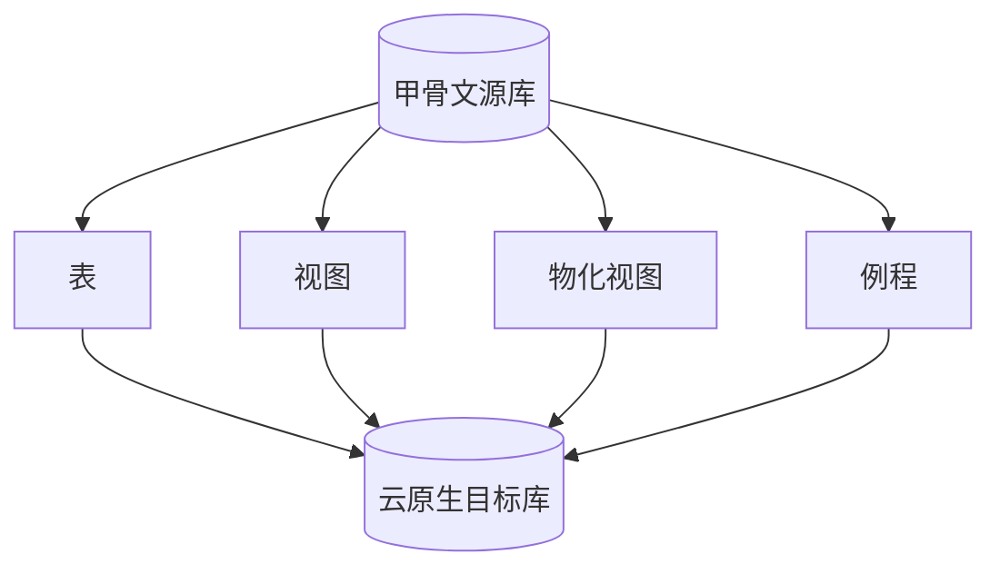

<!-- 项目简介页 · 完整文档见 README.md -->

  

<h2 align="center">甲骨文 11g 至 云原生 PostgreSQL</h2>
<h4 align="center">第十五版兼容引擎 · 企业级数据迁移</h4>

  
  
  
  
  

  <a href="README.md"><strong>📖 查看完整产品文档 →</strong></a>

 

---

## 项目定位

将 **Oracle 11g** 数据库结构与数据，安全、可控地迁移至 **PolarDB PostgreSQL（v15）** 兼容引擎。

> [!NOTE]
> 完整功能说明、架构图、API 与使用手册请参阅 **[README.md](README.md)**。

---

## 技术栈

<table>
  <tr>
    <th width="30%">层级</th>
    <th>技术选型</th>
  </tr>
  <tr>
    <td><strong>后端</strong></td>
    <td>Python 3.12 · Django 5.2 · Django REST Framework</td>
  </tr>
  <tr>
    <td><strong>前端</strong></td>
    <td>Vue 3 · TypeScript · Bootstrap 5 · Vite</td>
  </tr>
  <tr>
    <td><strong>管理后台</strong></td>
    <td>django-simpleui</td>
  </tr>
  <tr>
    <td><strong>数据库驱动</strong></td>
    <td>cx_Oracle · psycopg2</td>
  </tr>
</table>

---

## 版本要求

| 维度 | 规格 |
|:-----|:-----|
| **源端 Oracle** | Oracle Database 11g Enterprise Edition Release 11.2.0.4.0（64-bit），含 Partitioning / OLAP / Data Mining / Real Application Testing |
| **目标端** | 阿里云 PolarDB PostgreSQL · PostgreSQL v15 兼容 |
| **迁移范围** | 表 · 物化视图 · 视图 · 例程（及序列、触发器等，见完整文档） |

---

## 核心迁移能力

 

<table align="center">
  <tr>
    <td align="center" width="25%">
      <strong>📦 表</strong> 
      结构 + 数据 + 约束
    </td>
    <td align="center" width="25%">
      <strong>👁 视图</strong> 
      定义转换 / 物化
    </td>
    <td align="center" width="25%">
      <strong>📊 物化视图</strong> 
      MV 定义与数据
    </td>
    <td align="center" width="25%">
      <strong>⚙️ 例程</strong> 
      存储过程 / 函数
    </td>
  </tr>
</table>

---

## 快速链接

| 链接 | 说明 |
|:-----|:-----|
| [README.md](README.md) | 完整产品文档 · 架构 · 快速开始 |
| [docs/文档索引.md](docs/文档索引.md) | 全部子文档导航 |
| [README_VUE.md](README_VUE.md) | Vue 前后端项目结构说明 |

---

  © 2025–2026 · <a href="README.md">甲骨文至云数据库迁移平台</a>

